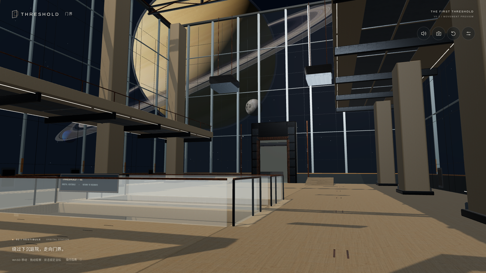
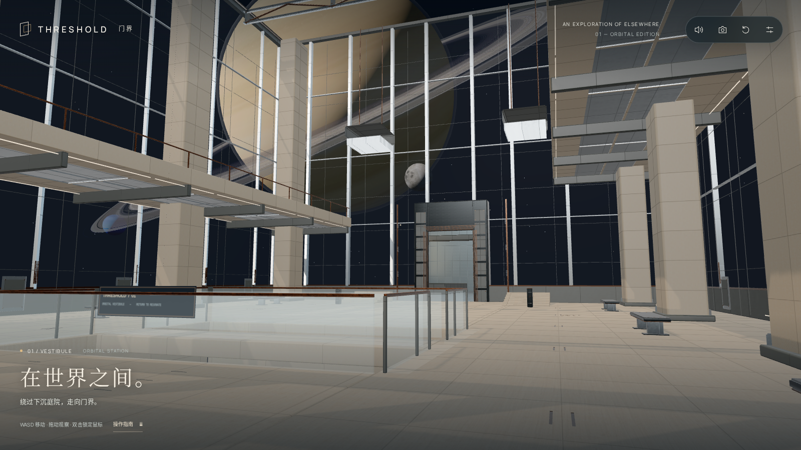
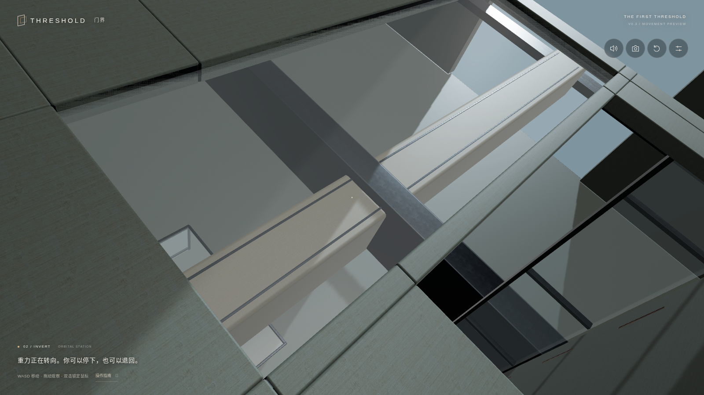
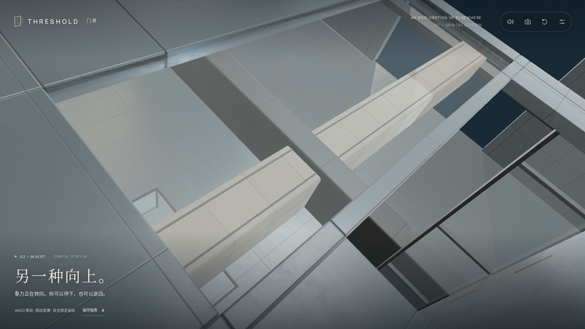
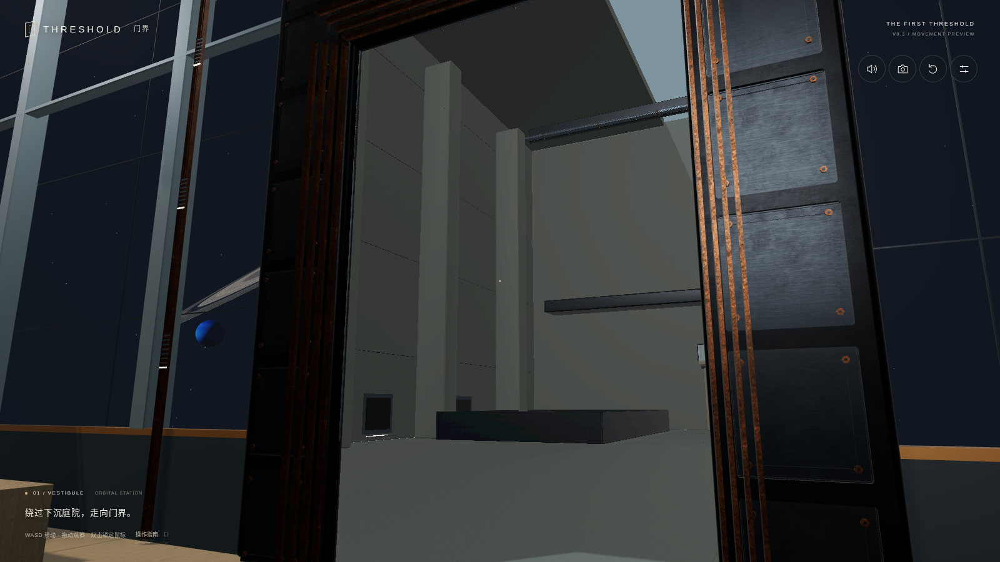
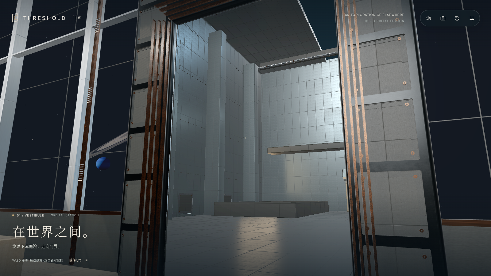
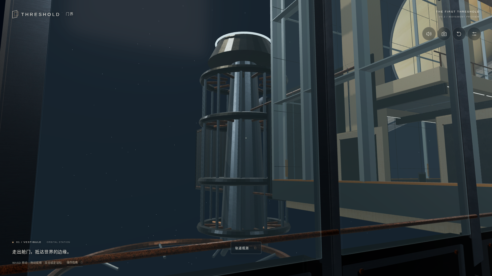
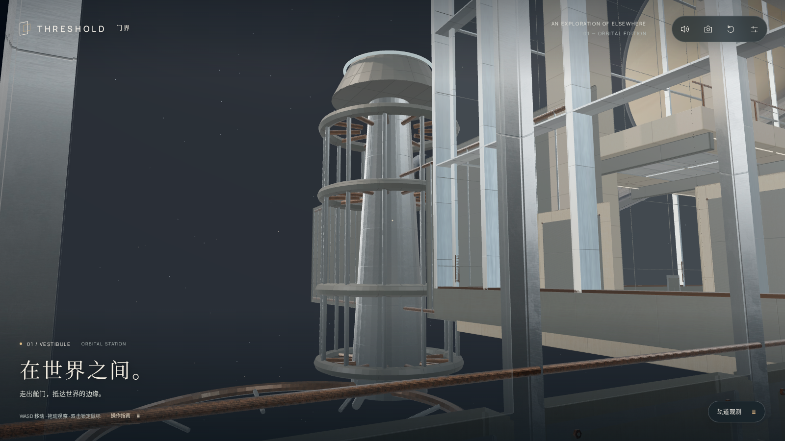
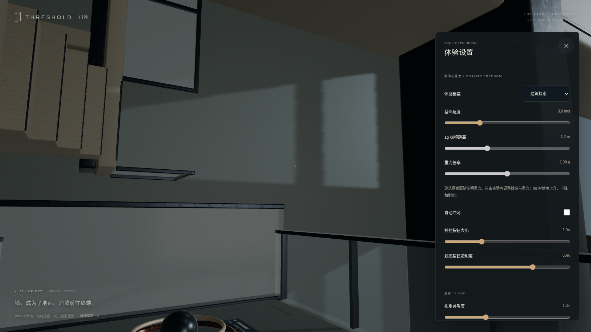
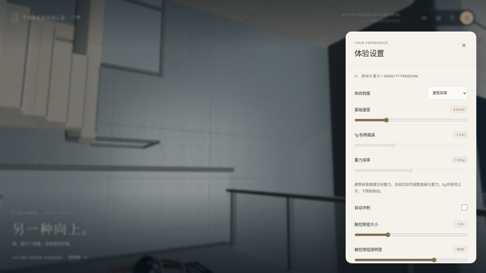

# Atelier / actual browser comparison

All images below are actual Chromium WebGL2 captures at 1600×900 and DPR 1. The camera poses match; physics is paused at the same presentation time for visual comparison. The source revision for the before image is 952176f. The after images show the implementation in 39b5d53. Dynamic/perspective/physical behavior is verified separately by the browser suites.

| View | Before | After |
| --- | --- | --- |
| Orbital arrival |  |  |
| Gravity transition |  |  |
| Portal approach |  |  |
| Pressure capsule |  |  |
| Settings |  |  |

The current paper-panel contrast is 12.7444:1 for the tested main text/background. Targeted keyboard, close actions and maximum touch-control layout checks are recorded separately. Browser emulation does not establish physical-device quality or performance.

Additional capture records: `evidence/atelier/{before,after}/capture.json`. Real UI at maximum touch size: [390px portrait](../evidence/atelier/mobile-390.png), [1170px landscape](../evidence/atelier/mobile-1170.png).

Source assets and the reproduction command are described in [the editable kit README](../assets/source/atelier/README.md). Implementation limits and exact verification status are in [the technical report](ATELIER_TECHNICAL_REPORT.md).
