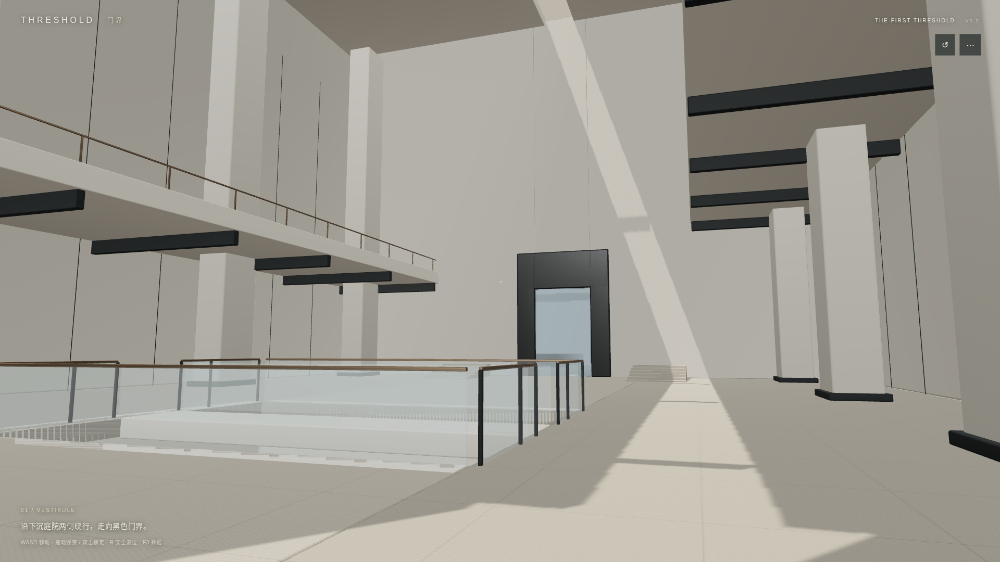
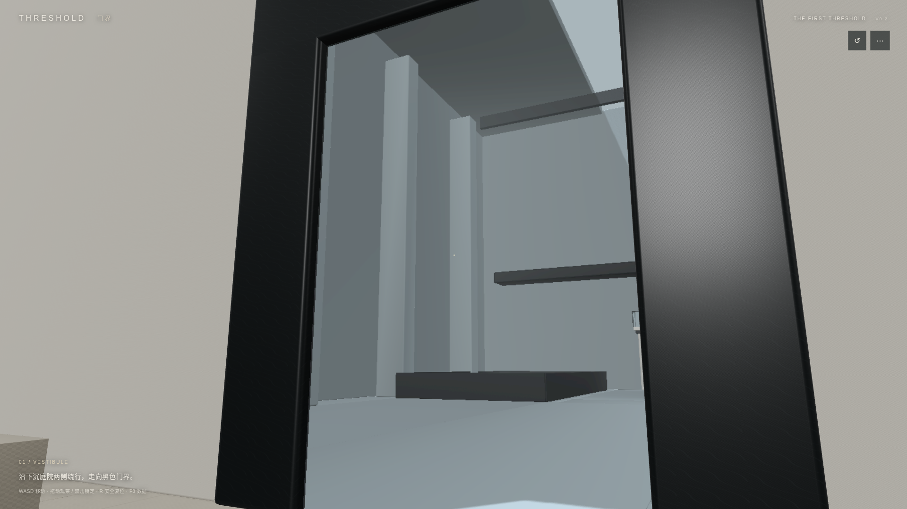
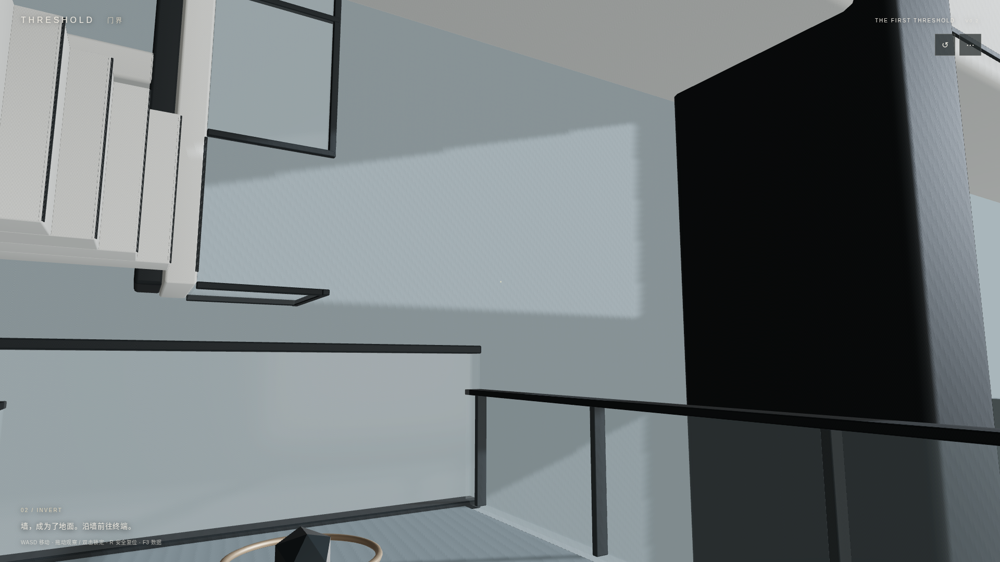

# V0.2 实机美术审查

本页审查实际Three.js/WebGL画面和可达模型。参考为assets/reference中的ARRIVAL、CROSSING与INVERSION_REJECTED；这些图片没有进入运行时背景或传送门纹理。图像未经ImageGen或修图处理。

## THE ARRIVAL

从14m压缩入口走出，24m中庭、两侧错层悬挑与肋、4m下沉庭院、实体桥、厚柱和8m黑色门共同形成纵深。顶部狭缝与定向光投下长影。地面真实绕开下沉区域，桥口处玻璃已断开并通过通行验证；建筑不是在一张完整平面上贴出“坑”。

矿物白、石灰岩、玄武岩、黑曜石与少量铜收口具有米制UV、细倒角、粗糙度和微法线变化。相较参考，结构、尺度和光区成立；局部间接光仅为烘焙AO加环境近似，尚不是完整路径追踪GI，远处材料与阴影细腻度存在差距。

## THE CROSSING

黑色外框6×8m，净洞3.6×5.6m、底边0，实际通行平面与PortalMath一致；可见内侧衬口与厚度。门中是独立INVERT Scene的实时三维画面。映射摄像机、屏幕采样和出口裁剪沿用G0并实际回归，靠近/穿越无加载黑屏。两个世界在进入可玩状态前预载，穿门时不以图片替换目标世界。

黑曜石保留低金属度与适度反射，没有霓虹描边、满屏Bloom或照片背景。目标纹理分档会改变清晰度，保持投影与视口比例；近门优先使用较高分辨率。

## THE INVERSION / CAM-03

脚底仍为CR1的(4.7,4,-12)，眼睛(3.15,4,-12)，真实胶囊与相机Up为(-1,0,0)，FOV50°。仅将LookAt调整为(2.2,7.6,-18)，原始悬挑、巨柱和锚点的AABB没有移动。

画面下方是实际支撑墙X=4.7；黑色“竖构件”是原本世界水平的悬挑，浅色“横构件”是未随玩家旋转的原竖向巨柱。左侧新增的原+Y重力楼梯和观察廊台提供人可以辨认的方向参照：玩家可在正常重力下真实上下走过它们，站上墙后它们转为横向。楼梯及护栏具有碰撞，最后一级与廊台合并以满足角色落脚宽度；并非摄影用无实体模型。

早期只检查AABB表面样本，存在“轴线可见、脚下墙已出框”的构图。现在保留表面首命中检查，并增加32×18屏幕射线：每条射线只记录第一个不透明真实三角面，合批face index保留asset_id。C3要求两轴各至少8个屏幕样本、真实支撑至少6个、旧楼梯至少8个；覆盖和身体状态都实际断言，数据见camera-visibility.json。该检查避免将仅一个代表点在视锥内误当成建筑主体可读。

近距离50°构图仍会裁切20m巨柱和21m悬挑的远端；目前通过旧楼梯、支撑墙和两轴同屏来表达方向矛盾，不能宣称完整建筑全貌均在一张图内。艺术目标按本轮内部实机对照审查，不引入外部审批门槛。

## CR1与自由探索证据

- [CAM-01：真实弧面起、中、末段与观察玻璃](../evidence/v02/C1-1920.png)
- [CAM-02：45°身体姿态与透窗看到的原始轴线](../evidence/v02/C2-1920.png)
- [实际姿态、表面首命中与屏幕区域数据](../evidence/v02/camera-visibility.json)
- [连续固定物理步与全部输入记录](../evidence/v02/continuous-path.json)
- [固定种子自由移动/观察](../evidence/v02/seeded-free-route.json)
- [真实生产键鼠录屏](../evidence/v02/production-journey.webm)

完整路径从实际出生点输入驱动，没有使用HERO机位定位。free-0/2/4/6.png是非预设摄影路线；触控1170×540、1200×540画面及JSON来自模拟浏览器，不能冒充Android真机。camera-audit、art-v3及C3-low/middle-free-look是诊断试拍，最终以*-1920.png与最新验证记录为准。

## 资产与修复

355个有稳定ID的Blender模块：VESTIBULE174个/15432三角面，INVERT181个/18356三角面；源.blend、标准GLB、18张源PBR图、独立碰撞数据与清单均交付。不可移动模型按材质合批，原轴线保留对象身份，其他模块通过三角面区间与GLB extras保留资产ID。

曾发现normal/roughness文件存在但像素全黑；现先设Non-Color再写像素并update，重新导出。单测解码GLB内PNG的实际通道值，验证法线和粗糙度，不以文件存在冒充正确PBR。

弧面/墙面具有0.55m真实闭合壳体。背侧接近、完整章节、30弧面往返、100墙行往返、旧重力楼梯上下行与停步均实际回归。新旧重力的建筑关系来自同一套三维几何，未旋转整个场景。

## 内部审查结论

| 项目 | 状态 | 实际范围 |
| --- | --- | --- |
| 真实资产、结构尺度、材质数据与可达性 | PASS | 可维护源文件、标准GLB、实体碰撞与真实浏览器图像 |
| 三机位与方向矛盾 | PASS | C1弧面；C2透窗；C3支撑墙/两轴/转横楼梯同屏，并有实际首命中与身体断言 |
| 参考光照与摄影完成度 | 有限制 | 已有定向天光、局部AO、PBR和结构厚度；全GI、精细阴影和摄影级最终润色未实现，不宣称AAA写实 |
| 真实设备视觉/性能覆盖 | BLOCKED | 未接入真实Android或桌面GPU，不能认证真机表现 |

总体保持PARTIALLY VERIFIED，真实设备门槛与上述视觉完成度限制均保留在报告中。
